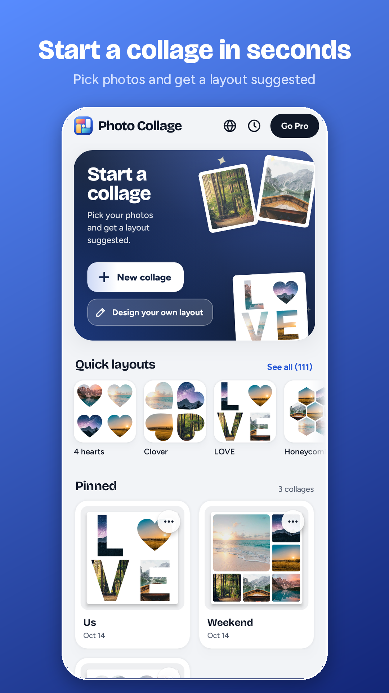
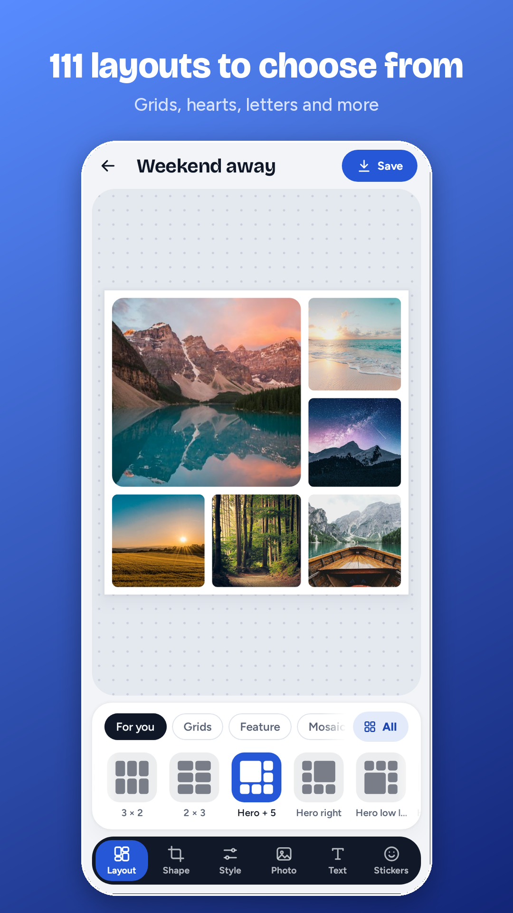
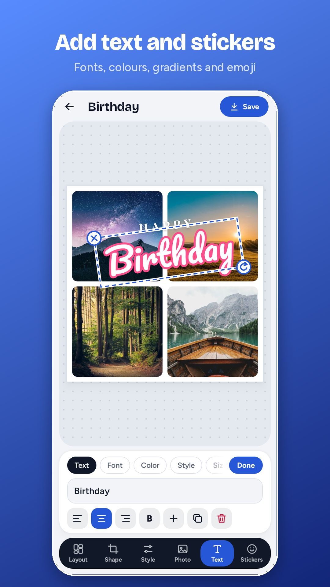
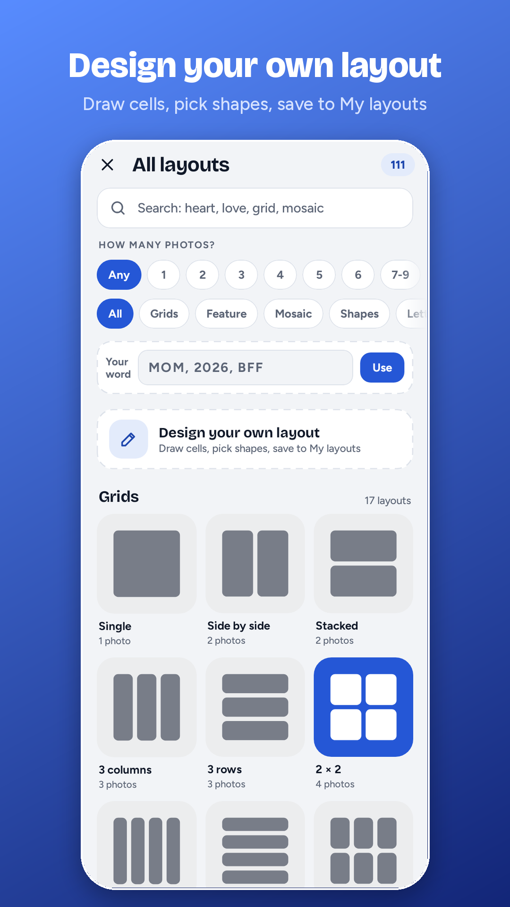

# Photo Collage

**Make photo collages in seconds.** Pick your photos, choose from more than 100 layouts, and make it yours with text, stickers, filters and frames. Free for Android, with no account and no sign-up.

[Get it on Google Play]({{PLAY_STORE_URL}})

   

## What you can do

**Create**

- Put up to 12 photos in one collage
- Choose from more than 100 layouts: grids, hearts, clover, honeycomb, letters, words and more
- Design your own layout: draw cells, pick shapes and save it to My layouts
- Pick a ready-made size for Instagram, Facebook, Pinterest, TikTok, YouTube, WhatsApp or print

**Make it yours**

- Zoom, move, rotate and flip each photo
- Adjust brightness, contrast and saturation, or pick a filter
- Use colours, gradients, textures or your own photo as the background
- Add frames and borders: polaroid, film strip, torn paper and more
- Set rounded corners, spacing and shapes for every cell

**Text and stickers**

- More than 50 fonts, with colours, gradients, outlines, shadows and curved text
- Ready-made text styles to start from
- Emoji and shape stickers

**Save and share**

- Save to your gallery in high quality, or share straight to your favourite apps
- Keep a History of every collage you have saved and open any of them again to keep editing

## Free, or Pro

Photo Collage is free to use. Collages you save carry a small Photo Collage mark in the corner.

**Photo Collage Pro** is a monthly subscription that removes the mark. It is billed through Google Play, so you can start, manage or cancel it at any time in Google Play. Price: £2.99 a month in the UK, and shown in your own currency in Google Play elsewhere.

## Private by design

Your photos stay on your phone. There is no account, no advertising and no tracking, and the app does not upload your photos or collages anywhere. Read the full [privacy policy]({{PRIVACY_URL}}).

## Languages

English, Español, Deutsch, Français, Italiano, Português, हिन्दी and Bahasa Indonesia. Change the language any time with the globe button on the Home screen, or let the app follow your phone.

## Good to know

- Works on Android 8.0 and newer, on phones and tablets
- Works without an internet connection (the internet is only used by Google Play to check your subscription)
- Saved collages go to Pictures, in a folder called Photo Collage

## Questions

**How do I remove the Photo Collage mark?**
Open Photo Collage, tap Go Pro on the Home screen, and subscribe. Collages you save afterwards have no mark.

**How do I cancel Pro?**
Open Google Play, tap your profile picture, then Payments and subscriptions, then Subscriptions, and choose Photo Collage. You keep Pro until the end of the period you have paid for.

**I subscribed on another phone. How do I get Pro back?**
Install Photo Collage, sign in to the same Google account, open Go Pro and tap Restore purchase.

**Where are my collages?**
Finished collages are saved to your gallery, in the Photo Collage folder. Collages you are still working on are in the app, on the Home screen.

**Does Photo Collage upload my photos?**
No. Everything happens on your phone.

**Something isn't working.**
Email us at {{SUPPORT_EMAIL}} and tell us what happened and which phone you have.

---

Photo Collage is made by {{COMPANY_NAME}}. Google Play and the Google Play logo are trademarks of Google LLC.
